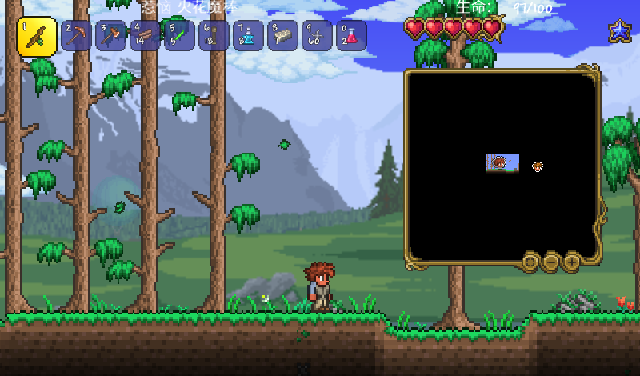

# terraria-headless-test

给 **tModLoader 1.4.4** 模组做自动化自测的一套工具：把专用服务器 + 真实客户端拉起来，用文件桥下发指令、
拿 `[TEST]` 断言，并且能**截真帧、点 UI、取像素**——全程不依赖你的手。

> 关键词：headless、无头测试、tModLoader、自动化截图、UI 断言、CI 自测

[](https://github.com/csyyywy/terraria-dev-skills/actions/workflows/ci.yml)

---

## 它解决什么问题

tModLoader 的专用服务器在**没有客户端时根本不 tick**：

```csharp
// Terraria.Main.DedServ_PostModLoad
if (Netplay.HasClients) Game.Update(...);   // 零客户端 → 世界不更新
```

所以"纯服务端自测"只能验加载期逻辑，验不了渲染、UI、动画、受伤特效、双端差异。
这个项目走**双层**方案：

| 层 | 组成 | 能测什么 | 量级 |
|---|---|---|---|
| **L1** | 专用服务器 + 假连接（占一个 socket 槽位让 `HasClients` 为真） | 世界逻辑、生成、配方、存档往返、断言 | 冷启 10–15s，热会话单条 **0.4–0.6s** |
| **L2** | 上面的 + 一个真实客户端（无窗口/最小化，静音） | 真帧截图、UI 点击、像素断言、双端对比 | 冷启 250–270s（首次加载模组/世界），热会话单条 **1.3–3.4s** |

热会话：一次启动，反复下发命令（`session.ps1`），单条命令约 **1 秒**。

---

## 实拍：它真的在跑

下面两张都是**测试用例自己拍的**（`c:shot`），不是人按 F12：



*L2 客户端进世界；`c:ui inventory` 打开背包再截图。窗口是最小化的，键盘/鼠标走进程内注入。*


*`c:shot probe-region 90 90 270 70` 只拍 270×70 的区域：左=物品贴图，中=MagicPixel，右=原版 UI 贴图。*

同一帧还能直接断言像素，不用人眼看图：

```
[PASS] assertpix :: at=110,110 got=f71318 want=ff0000 d=8,19,24 tol=60
[PASS] assertpix :: at=210,110 got=ffffff want=ffffff d=0,0,0 tol=20
[PASS] assertpix :: at=310,110 got=3f5297 want=0000ff d=63,82,104 tol=200
[PASS] shot:l2suite      157218 bytes, 800x720
[PASS] shotstat:l2suite  distinct=560 nonUniform=0.653
```

`shotstat` 的 `distinct`（颜色种类）与 `nonUniform`（非主导色占比）可以当“面板是不是空的”的断言，
不用再靠人眼判断。
## 快速开始

```powershell
# 0) 前置：tModLoader 安装目录（后面统一叫 <TML_DIR>）
#    Windows / .NET 8 / PowerShell 7

# 1) L1：起服务器跑一条断言
pwsh -File resources/scripts/tml.ps1 `
  -Lab smoke -ModName <你的模组> -Tmod <path/to/YourMod.tmod> -TmlDir <TML_DIR> `
  -Commands 'ping' -Expect ping

# 2) 热会话：起一次，之后反复下发
pwsh -File resources/scripts/tml.ps1 -Lab dev -ModName <你的模组> -Tmod <...：.tmod> -TmlDir <TML_DIR> -Detach
pwsh -File resources/scripts/session.ps1 -Action Poll -Lab dev        # 永不阻塞：ready / starting
pwsh -File resources/scripts/session.ps1 -Action Run  -Lab dev -Commands 's:ping'

# 3) L2：带客户端，截图 + 像素断言
pwsh -File resources/scripts/tml.ps1 -Lab ui -ModName <你的模组> -Tmod <...> -TmlDir <TML_DIR> `
  -Client -Player TestPlayer -MinimizeClient -Detach
pwsh -File resources/scripts/session.ps1 -Action Run -Lab ui `
  -Commands 'c:ui inventory;c:wait 30;c:shot bag;c:assertpix 400 300 #ffffff 30'
```

产物在 `~/.tmlkit/labs/<lab>/`：`out/*.png`、`out/log-*.txt`、`out/boot-*.log`、`.session.json`。

---

## 关键设计（都是被坑出来的）

- **空服务器不 tick** → 用假连接（`HeadlessLink`）占住 `Netplay.Clients[254]`；L2 时必须 `link off`，否则真客户端被挤掉。
- **子进程绝不能继承调用方 stdout** → 一律 `Start-Process` / `cmd >> file`。否则它活得比调用方久，调用方永远等不到 EOF（表现为"命令卡死"）。
- **启动期可见性** → server/client 的原始输出用 OS 级重定向落到 `out/boot-*.log`，**模组没加载也能看**。
- **快失败** → 命中 `Missing mod` / `ModSortingException` / 端口占用 / 模态框字样，数秒内报错（实测缺依赖 6.8s）。
- **等待有预算** → 任何入口最多阻塞 `-MaxWaitSec`（默认 30s）；要更久就 `Poll` 轮询，不堵调用方。
- **截图取后缓冲**，不是屏幕抓取：压在游戏窗口上的任何窗口都进不了图。
- **像素断言同帧取色**（`assertpix`），避免"日志是 fit 前那帧、截图是 60 tick 后"的跨帧错位。

---

## 指令与断言

文件桥：`in/cmd-<server|client>.txt` 下发；`out/result-<side>.txt` 收 `[TEST] <case> PASS|FAIL <detail>`。

常用动词（完整表见 `resources/03-verbs.md`）：

| 类别 | 动词 |
|---|---|
| 读取 | `ping`（带 `bridge=<版本>`）、`diag`、`tick`、`state`、`count`、`find`、`tile` |
| 世界 | `spawn` `give` `tp` `time` `weather` `save` |
| 控制 | `wait <ticks>`（也支持 `20t`/`1s`）、`waitfor`、`shot [区域]`、`exit` |
| 界面 | `ui <名字>`、`key`、`mouse`、`click`、`wheel`、`uiact` |
| 断言 | `assert hp>=60`、`assertpix <x> <y> <#rrggbb> [tol]` |

**关于 UI 输入**：`key/click/wheel` 注入的是原版输入管线（`PlayerInput` + `Main.mouseLeft/Release`）。
自绘 UI 若自己读 `Mouse.GetState()`（只读系统状态），注入永远到不了——这类界面请由模组注册
`DevBridge.RegisterUiAction("zoom", args => …)`，测试用 `uiact zoom +1`。

---

## 目录

```
SKILL.md                  给 AI 助手用的操作手册（硬规则/动词/排错）
resources/01-architecture.md   架构与"为什么这样设计"
resources/02-protocol.md       文件桥协议
resources/03-verbs.md          动词全集
resources/04-client-mode.md    L2 客户端前置条件
resources/05-gotchas.md        症状 → 原因 → 处理
resources/06-verification.md   实测数据与验收清单
resources/bridge/*.cs          可 vendored 进模组的 C# 桥（DevBridge/Shot/Player/Link）
resources/scripts/*.ps1        tml / session / suites / boot-log / win-ui / preflight-client
resources/suites/*.json        可直接跑的用例集
resources/recipes/*.json       可复用动作序列
resources/config/client-config.json  客户端最小可用配置模板（已去标识）
docs/                     设计取舍（含被否决的方案与原因）
```

---

## 在 CI 里跑

仓库自带两个工作流：

| 工作流 | 跑在哪 | 做什么 |
|---|---|---|
| `ci.yml` | GitHub 托管 runner（windows-latest） | 脚本语法、JSON 结构、文档引用、隐私扫描、`-PlanOnly` 冒烟；**不需要游戏** |
| `l2-selfhosted.yml` | 自托管 Windows runner（标签 `tmodloader`） | 体检 → 起客户端 → 跑 suite → **上传截图与日志 artifact** |

托管 runner 上能跑的部分，本地也能一条命令复现：

```powershell
pwsh -File scripts/ci-check.ps1                       # 检查本技能
pwsh -File scripts/ci-check.ps1 -SkillRoot ../其他技能  # 检查别的技能
```

自托管那份需要三个仓库变量：`TML_DIR`、`TMOD_PATH`、`MOD_NAME`（可选 `PLAYER_NAME`）。
它只做一件事：**让你在 PR 里看到真实截图**，而不是“我这边能跑”。
## 前置与限制

- Windows + PowerShell 7 + .NET 8；tModLoader **1.4.4**（API 随版本变动，其他版本未验证）。
- L2 需要 **Steam 正在运行**，且客户端要有完整 `config.json`（仓库内模板已可用）。
- 不修改游戏文件、不注入宿主进程、不读内存；全部通过公开 API 与文件通信。
- 不附带任何 Terraria 素材（贴图/音效/世界）；测试世界由服务端 `autocreate` 现场生成。
- 本项目是**测试工具**，不是游戏本体或模组分发渠道。

---

## 致谢与许可

- tModLoader（MIT）—— 本工具运行在其 API 之上，未复制其源码。
- Terraria —— 商业游戏，本项目不包含其任何素材。
- 第三方库/框架的引用与出处见 [NOTICE.md](../NOTICE.md)。
- 本项目代码许可：MIT，见 [LICENSE](../LICENSE)。
